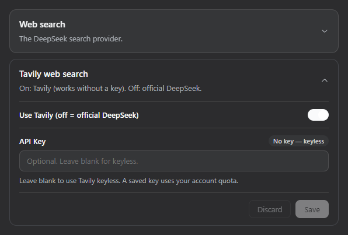

# dsh-tavily

[中文](README.md) | English

[](https://awesome-dsh-plugin.com) [](https://dshfind.com/zh/plugins/SZMY-haruhi/dsh-tavily?ref=badge)

Tavily web search for [DeepSeek Harness](https://github.com/deepseek-ai/deepseek-harness). Adds Tavily Search API as a web search provider for DSH.

## Install

npm (stable, official recommendation):

```sh
dsh plugin --profile web add dsh-tavily
dsh web
```

Or follow GitHub (latest commit on the repo):

```sh
dsh plugin --profile web add github:SZMY-haruhi/dsh-tavily
dsh web
```

Sidebar **Plugins** → installed **dsh-tavily** → the **web-search-tavily** row’s configuration page: turn the toggle on. The key is optional; leave it blank for keyless. **Test connection** on that page checks that search works now (including keyless).

**Please update to 0.3.2.** 0.3.1 and earlier mount the card with DSH 0.1’s `settings.register` and `settings.plugin.item`. DSH 0.2 removed that API and slot, so the plugin fails during startup and the card has no entry. 0.3.2 registers `plugins.row.config` on the Plugins page. npm:

```sh
dsh plugin --profile web update dsh-tavily
```

GitHub installs: run `add github:SZMY-haruhi/dsh-tavily` again.

<p align="center">
  
</p>

Pin a commit:

```sh
dsh plugin --profile web add github:SZMY-haruhi/dsh-tavily#<commit>
```

Remove:

```sh
dsh plugin --profile web remove dsh-tavily
```

> `dsh.bundle` · prebuilt `lib/` · git install does not need `allowBuilds`


## Features

- Plugins-page toggle: off = official DeepSeek, on = Tavily — no uninstall to switch back
- No key uses Tavily keyless; a key uses `Authorization: Bearer`
- Bottom-left connection test: one real Tavily search (`max_results: 1`); keyless if no key, account quota if a key is saved (1 credit)
- Timeout, abort, official host lock, drop results without a url
- Key and toggle live on the credentials plane, not the settings file


## Behavior


| Toggle        | Key   | `web_search`         |
| ------------- | ----- | -------------------- |
| Off (default) | —     | official DeepSeek    |
| On            | empty | Tavily keyless       |
| On            | set   | Tavily account quota |


Provider id: `tavily`.

## Credentials


| Ref                     | Meaning                                             |
| ----------------------- | --------------------------------------------------- |
| `TAVILY_API_KEY`        | Optional. Present = account quota; absent = keyless |
| `TAVILY_SEARCH_ENABLED` | Present = on; unset = off                           |


You can also put these in `$DSH_HOME/.credentials.yaml`. Do not commit real keys.

The Plugins-page card always reads and writes `TAVILY_API_KEY` and `TAVILY_SEARCH_ENABLED`. The cordis field `apiKeyEnv` only changes which reference the host resolver and the connection test use when there is no draft key. They name the same reference only while `apiKeyEnv` stays at the default `TAVILY_API_KEY`. A different `apiKeyEnv` leaves the card on `TAVILY_API_KEY` while search and the test read the new name.

## Updates

- **2026-10-12** **0.3.2 (please update)** DSH 0.2: drop the removed `settings.register`; move the card from `settings.plugin.item` to `plugins.row.config` on the Plugins page (`dsh-tavily#web-search-tavily`); read and write credentials through `remote.credentials` and refresh on `credentials/reference-updated`; snapshot store is the peer `@deepseek-ai/dsh-client-store` so it shares the host instance. Peers stay on 0.2.x (including `0.2.0-rc.2` and `0.2.1-alpha`) and cordis 4.x. A failed save shows its error code; a failed credential read locks the toggle. The connection test is a POST-only `connection.fetch` route, so an anonymous request gets the host's 401. `@deepseek-ai/dsh-client-connection` is a peer because the plugin injects `connection`. Toggle and key still live on credentials.
- **2026-08-17** **0.3.1** Fix: installing alongside other client plugins could freeze Web on “Failed to load plugins / dsh-tavily” (the then-current `settings.plugin.item` needed `key`). That slot is gone in DSH 0.2; use 0.3.2.
- **2026-08-17** Configuration page: Test connection at the bottom-left. Works without a key (Tavily keyless). A saved key uses the account path and 1 credit. Does not change the toggle or Save.

---


## Author

<a href="https://tonkatsu258.vercel.app/index.html">
  
</a>

**Thanks for the star ❤️**
**[tonkatsu258](https://tonkatsu258.vercel.app/index.html)** · [personal site](https://tonkatsu258.vercel.app/index.html)
