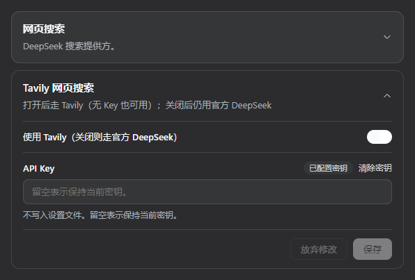

# dsh-tavily

中文 | [English](README.en.md)

[](https://awesome-dsh-plugin.com) [](https://dshfind.com/zh/plugins/SZMY-haruhi/dsh-tavily?ref=badge)

[DeepSeek Harness](https://github.com/deepseek-ai/deepseek-harness) 的 Tavily 网页搜索。作为其网页搜索服务提供商。

## 安装

npm（稳定版，官方推荐）：

```sh
dsh plugin --profile web add dsh-tavily
```

也可以跟 GitHub（跟仓库最新提交）：

```sh
dsh plugin --profile web add github:SZMY-haruhi/dsh-tavily
```

侧栏 **插件** → 已安装的 **dsh-tavily** → 组件 **web-search-tavily** 的配置页：打开开关即可。Key 可选，不填走无 Key。页内「连通测试」可确认现在能不能搜（无 Key 也测得通）。

**请更新到 0.3.2。** 0.3.1 及更早版本按 DSH 0.1 的 `settings.register` + `settings.plugin.item` 注册入口。DSH 0.2 起该接口和插槽已移除，插件会在启动时失败，设置页也没有入口。0.3.2 改到插件页的 `plugins.row.config`。npm：

```sh
dsh plugin --profile web update dsh-tavily
```

GitHub 安装则再执行一次 `add github:SZMY-haruhi/dsh-tavily`。

<p align="center">
  
</p>

钉 commit：

```sh
dsh plugin --profile web add github:SZMY-haruhi/dsh-tavily#<commit>
```

卸载：

```sh
dsh plugin --profile web remove dsh-tavily
```

> `dsh.bundle` · 预构建 `lib/` · git 安装无需 `allowBuilds`


## 特点

- 插件页开关：关 = 官方 DeepSeek，开 = Tavily，不用卸包
- 无 Key 走 Tavily keyless；有 Key 走 `Authorization: Bearer`
- 左下连通测试：真打一次 Tavily（`max_results: 1`）；无 Key 走 keyless，有 Key 走账号档（消耗 1 积分）
- 超时、中止、官方 Host 锁定、丢掉无 url 的结果
- Key / 开关写在 credentials，不写设置文件


## 行为


| 开关    | Key | `web_search`   |
| ----- | --- | -------------- |
| 关（默认） | —   | 官方 DeepSeek    |
| 开     | 未填  | Tavily keyless |
| 开     | 已填  | Tavily 账号档     |


Provider id：`tavily`。

## 凭证


| 引用                      | 含义                   |
| ----------------------- | -------------------- |
| `TAVILY_API_KEY`        | 可选。有则走账号档；无则 keyless |
| `TAVILY_SEARCH_ENABLED` | 有此项则为开；删除即关          |


可写在 `$DSH_HOME/.credentials.yaml`。不要把真实钥匙提交进仓库。

插件页上的卡片固定读写 `TAVILY_API_KEY` 和 `TAVILY_SEARCH_ENABLED`。cordis 配置里的 `apiKeyEnv` 只影响宿主解析密钥、以及连通测试在没有草稿 Key 时去读哪一条引用。只有 `apiKeyEnv` 保持默认 `TAVILY_API_KEY` 时，卡片和搜索用的是同一条引用。改成别的名字后，卡片仍改 `TAVILY_API_KEY`，搜索和测试会去读新名字。

## 更新

- **2026-10-12** **0.3.2（请更新）** 适配 DSH 0.2：去掉已删除的 `settings.register`；配置入口从 `settings.plugin.item` 改到插件页 `plugins.row.config`（`dsh-tavily#web-search-tavily`）；凭证读写改走 `remote.credentials`，刷新事件改为 `credentials/reference-updated`；快照 store 改为 `@deepseek-ai/dsh-client-store`（peer，与宿主共用同一份）。peer 收在 0.2.x（含 `0.2.0-rc.2` 与 `0.2.1-alpha`）和 cordis 4.x。保存失败会显示错误码，读凭证失败则锁定开关。连通测试改走 `connection.fetch`，未登录请求由宿主返回 401。开关与 Key 仍走 credentials。
- **2026-08-17** **0.3.1** 修复：与其它客户端插件同时安装时，Web 可能卡在「Failed to load plugins / dsh-tavily」（当时的 `settings.plugin.item` 需 `key`）。该插槽在 DSH 0.2 已移除，请改用 0.3.2。
- **2026-08-17** 配置页左下增加连通测试。无 Key 也可测（走 Tavily keyless）；有已存 Key 则走账号档，消耗 1 积分。不改开关、不占用保存。

---


## Author

<a href="https://tonkatsu258.vercel.app/index.html">
  
</a>

**感谢star❤️**
**[tonkatsu258](https://tonkatsu258.vercel.app/index.html)** · [个人网站](https://tonkatsu258.vercel.app/index.html)
